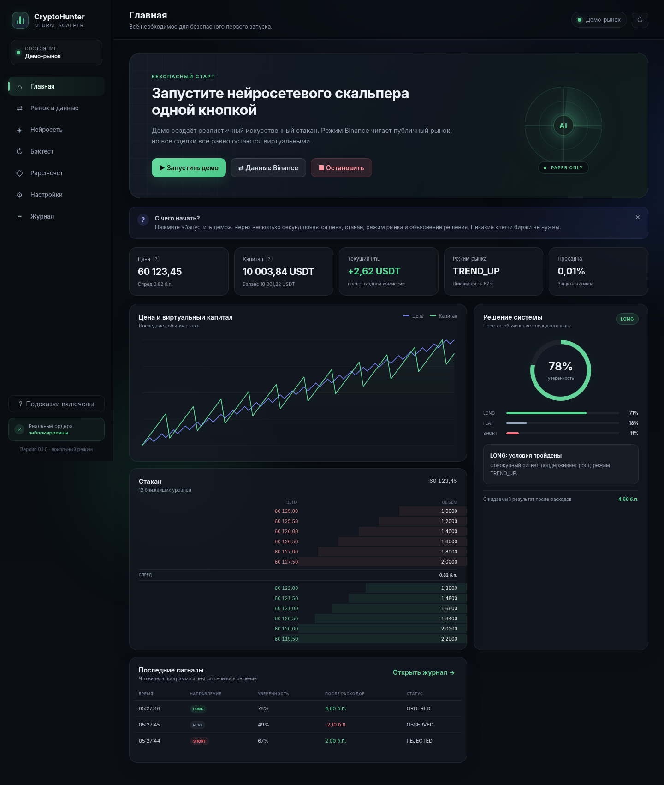

# CryptoHunter Neural Scalper

**Локальная исследовательская платформа для нейросетевого скальпинга по стакану криптовалютной биржи.**

Программа получает публичные рыночные данные, восстанавливает локальный стакан, рассчитывает признаки микроструктуры, формирует объяснимый сигнал, проверяет его жёстким риск-контуром и воспроизводит сделку на виртуальном счёте. Внутри также находятся обучение модели, событийный бэктест, запись истории и современный русскоязычный интерфейс в тёмных тонах.

> **Важно:** версия 0.1.1 не отправляет реальные ордера. Код live-исполнения отсутствует намеренно. Программа предназначена для исследования, сбора данных, обучения, бэктеста и paper-trading.



*На изображении показан демонстрационный интерфейс. Значения не являются доказательством доходности.*

## Что уже реализовано

- установка и запуск в Ubuntu через `INSTALL_UBUNTU.sh`, затем из меню приложений в два клика;
- локальный интерфейс на русском языке по адресу `http://127.0.0.1:8094`;
- демонстрационный рынок для знакомства без API-ключей;
- публичный поток Binance USD-M Futures без торговых ключей;
- восстановление L2-стакана из REST snapshot и последовательных WebSocket diff-событий;
- контроль разрывов последовательности, crossed book, задержки и ценовых выбросов;
- запись стакана и признаков в почасовые `jsonl.gz` файлы;
- 36 признаков микроструктуры рынка;
- нейросеть `CNN → residual blocks → GRU → attention`;
- три выхода модели: направление, ожидаемое исполнимое движение и волатильность;
- прозрачный математический baseline до обучения нейросети;
- роутер рыночных режимов с ограниченной памятью результатов;
- семь объяснимых стратегий-помощников;
- жёсткий риск-менеджер, который не может быть обойдён моделью;
- market, limit и post-only модель заявок;
- задержка, очередь перед заявкой, комиссии, проскальзывание и отмена по тайм-ауту;
- виртуальный счёт, стоп, тейк-профит, trailing stop и ограничение времени позиции;
- синтетическое и записанное обучение;
- хронологическое разделение train/validation/test;
- событийный бэктест и отчёт с торговыми метриками;
- SQLite-журнал сигналов, отказов, сделок и запусков;
- восстановление paper-состояния после перезапуска;
- модуль интеграции в экосистему CryptoHunter;
- автоматические тесты и GitHub Actions workflow.

## Запуск в два клика

### Ubuntu — рекомендуемый сценарий

1. Распакуйте `.tar.gz` в постоянную папку.
2. Один раз выполните:

   ```bash
   chmod +x INSTALL_UBUNTU.sh
   ./INSTALL_UBUNTU.sh
   ```

3. После установки откройте **CryptoHunter Neural Scalper** из меню приложений Ubuntu.

Установщик подготовит Python 3.12 через `uv`, создаст `.venv`, установит зависимости и добавит ярлыки запуска/остановки. Из терминала программа запускается командой:

```bash
./start.sh
```

Остановка:

```bash
./STOP.sh
```

Публикация проекта в новый private-репозиторий GitHub:

```bash
./PUBLISH_TO_GITHUB.sh
```

Подробности: [полная инструкция для Ubuntu](docs/UBUNTU_RU.md).

### Windows

1. Распакуйте проект, например в `D:\CryptoHunter-Neural-Scalper`.
2. Дважды щёлкните `START.bat`.

Для остановки используйте `STOP.bat`, для ярлыка — `CREATE_DESKTOP_SHORTCUT.bat`.

## Первый безопасный сценарий

1. Откройте **«Главная»** и нажмите **«Запустить демо»**.
2. Убедитесь, что цена, стакан, режим и счёт обновляются.
3. Откройте **«Бэктест»** и выполните синтетический прогон.
4. Откройте **«Нейросеть»** и обучите тестовую модель на синтетике.
5. Перейдите в **«Рынок и данные»** и подключите публичный Binance-поток.
6. Запишите реальный стакан.
7. Обучите модель на записанных данных.
8. Проведите recorded-data backtest и длительный paper-прогон.

Синтетический прогон проверяет механику программы, но не подтверждает наличие торгового преимущества.

## Как принимается решение

```text
Публичные данные / демо
          ↓
Локальный стакан + сделки + ликвидации
          ↓
Контроль качества данных
          ↓
36 признаков + последовательность LOB [T, L, 4]
          ↓
Нейросеть или прозрачный baseline
          ↓
Стратегии-помощники
          ↓
Роутер рыночного режима
          ↓
Оценка движения после расходов
          ↓
Жёсткий риск-менеджер
          ↓
Paper-брокер и событийная модель исполнения
          ↓
Журнал, графики и отчёт
```

## Основные страницы интерфейса

| Раздел | Назначение |
|---|---|
| **Главная** | запуск, цена, капитал, сигнал, объяснение, стакан и последние решения |
| **Рынок и данные** | демо, Binance, состояние соединения и запись истории |
| **Нейросеть** | состояние модели, устройство, запуск обучения и прогресс |
| **Бэктест** | новый прогон, метрики, кривая капитала и причины отказов |
| **Paper-счёт** | позиция, PnL, стопы, сделки и аварийная защита |
| **Настройки** | рынок, модель, исполнение, риск и стратегии |
| **Журнал** | сигналы, отклонения, сделки, ошибки и системные события |

## Документация

Полное оглавление находится в [`docs/README.md`](docs/README.md).

Для быстрого начала:

- [Подробное описание программы](docs/PROGRAM_DESCRIPTION_RU.md)
- [Ubuntu: установка, запуск, GPU и GitHub](docs/UBUNTU_RU.md)
- [Установка и запуск на разных ОС](docs/INSTALLATION_RU.md)
- [Первый запуск](docs/FIRST_RUN_RU.md)
- [Полное руководство пользователя](docs/USER_MANUAL_RU.md)
- [Описание интерфейса](docs/INTERFACE_RU.md)
- [Все параметры](docs/CONFIGURATION_REFERENCE_RU.md)
- [Обучение нейросети](docs/MODEL_AND_TRAINING_RU.md)
- [Бэктест](docs/BACKTEST_RU.md)
- [Риск-менеджмент](docs/RISK_MANAGEMENT_RU.md)
- [Решение проблем](docs/TROUBLESHOOTING_RU.md)
- [Отчёт проверки Ubuntu-сборки 0.1.1](docs/QUALITY_REPORT_0.1.1_RU.md)

Для разработчика:

- [Архитектура](docs/ARCHITECTURE_RU.md)
- [API](docs/API_REFERENCE_RU.md)
- [Форматы данных](docs/DATA_FORMATS_RU.md)
- [Руководство разработчика](docs/DEVELOPER_GUIDE_RU.md)
- [Интеграция с CryptoHunter](docs/INTEGRATION_CRYPTOHUNTER_RU.md)

## Структура проекта

```text
CryptoHunter-Neural-Scalper/
├── INSTALL_UBUNTU.sh               # однократная установка и ярлыки Ubuntu
├── start.sh                        # запуск Ubuntu/Linux
├── STOP.sh / STOP_UBUNTU.sh       # безопасная остановка Ubuntu/Linux
├── RUN_TESTS.sh                    # тесты Ubuntu/Linux
├── CHECK_GPU.sh                    # проверка PyTorch/CUDA
├── PUBLISH_TO_GITHUB.sh            # публикация через GitHub CLI
├── START.bat / STOP.bat            # совместимость Windows
├── PUBLISH_TO_GITHUB.bat           # публикация Windows
├── pyproject.toml
├── requirements.txt
├── docs/                           # русская документация
├── integration/cryptohunter_program/
├── src/neuroscalper/
│   ├── market/                     # источники, стакан, качество, запись
│   ├── features/                   # микроструктурные признаки
│   ├── models/                     # нейросеть, baseline и роутер
│   ├── strategies/                 # объяснимые компоненты
│   ├── execution/                  # paper-брокер и fill-модель
│   ├── risk/                       # независимые ограничения риска
│   ├── training/                   # датасет и обучение
│   ├── backtest/                   # replay и метрики
│   ├── web/                        # FastAPI и тёмный интерфейс
│   └── runtime.py                  # единый управляющий контур
├── tests/
└── var/                            # данные, модели, логи и отчёты
```

## Где сохраняются результаты

```text
var/
├── data/
│   ├── config.json
│   ├── paper_state.json
│   ├── router_memory.json
│   ├── neuroscalper.db
│   └── records/<SYMBOL>/
├── logs/neuroscalper.log
├── models/
│   ├── best_model.pt
│   ├── best_model.json
│   └── lob_scalper_<timestamp>.pt
└── reports/latest_backtest.json
```

Для полного резервного копирования достаточно остановить программу и скопировать папку `var/`.

## Проверка проекта

На Ubuntu:

```bash
./RUN_TESTS.sh
```

Ручная проверка:

```bash
.venv/bin/python -m pip install -r requirements-dev.txt
PYTHONPATH=src .venv/bin/python -m pytest -q
PYTHONPATH=src .venv/bin/python -m compileall -q src tests integration
node --check src/neuroscalper/web/static/app.js
```

На Windows сохранён `RUN_TESTS.bat`. Текущая сборка проходит **9 автоматических тестов**.

## Критические ограничения 0.1.1

- реальных ордеров нет;
- одновременно анализируется один символ;
- реализован только публичный Binance USD-M Futures collector;
- используется L2/market-by-price, поэтому точная позиция заявки в биржевой очереди неизвестна;
- после прохождения модельной очереди лимитное исполнение атомарное, без частичного остатка;
- горизонт метки задаётся 12 событиями, а не фиксированным временем;
- нет walk-forward orchestration и purge/embargo;
- нет SAC execution-agent;
- нет доказанной доходности.

## Права и происхождение архитектуры

Код этой сборки написан как clean-room интеграция. Использованы общие архитектурные идеи из исследований DeepLOB, EarnHFT, MacroHFT, DeepScalper, JaxMARL-HFT, hftbacktest и TorchTrade, а также требования и инженерные решения из проектов CryptoHunter, AI Trader, Drops, Liquidations, ImPulse и других проектов владельца.

Подробности находятся в [`NOTICE.md`](NOTICE.md) и [`docs/THIRD_PARTY_IDEAS_RU.md`](docs/THIRD_PARTY_IDEAS_RU.md).
Условия частного использования: [`LICENSE`](LICENSE). История версий: [`CHANGELOG.md`](CHANGELOG.md).

## Статус

- версия: `0.1.1`;
- режим: research / paper;
- live execution: заблокирован;
- основной язык документации и интерфейса: русский;
- рекомендуемый тип репозитория: private.
